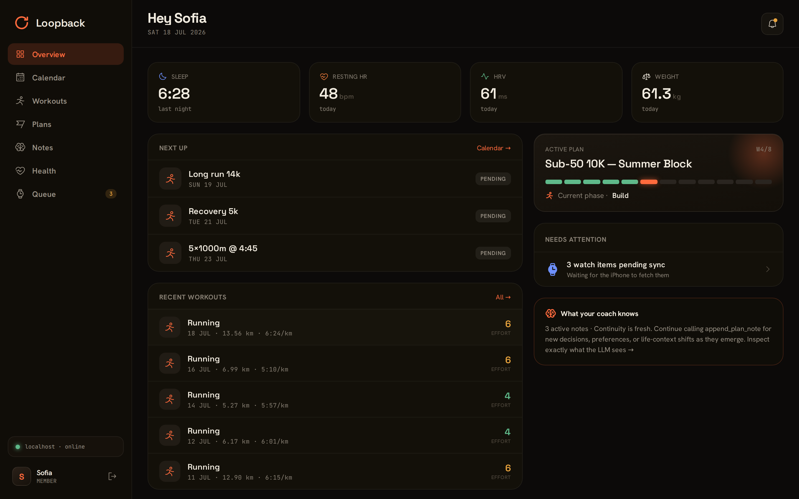
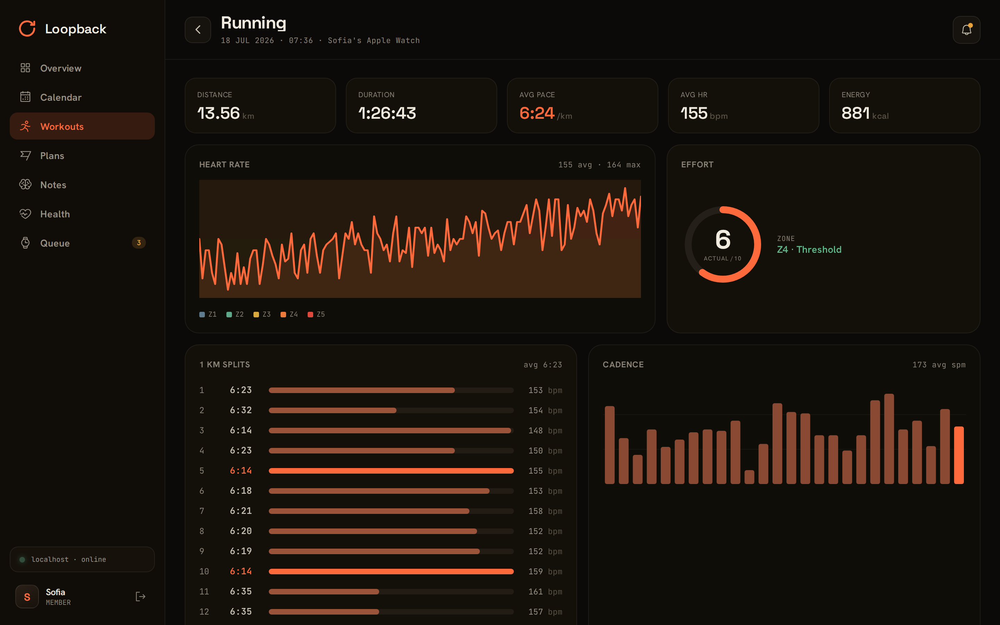
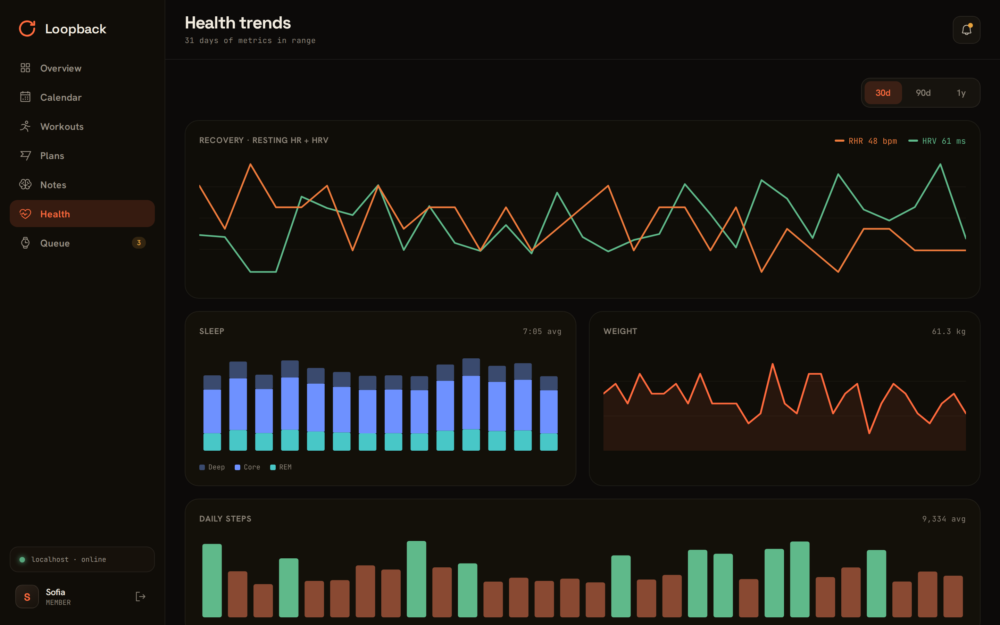

# Loopback Server

[](https://github.com/aderaaij/loopback-training-server/actions/workflows/ci.yml)
[](https://github.com/aderaaij/loopback-training-server/actions/workflows/docker-publish.yml)

The self-hosted backend behind **Loopback – Run Coach**, an iOS running app. It stores workout history, queues structured workouts for delivery to Apple Watch via WorkoutKit, manages training plans and daily health metrics, and serves an authenticated web dashboard for athletes and admins.

**Website: [loopback.ardenlab.dev](https://loopback.ardenlab.dev/)**

Built with FastAPI, PostgreSQL, SQLAlchemy, and React. Includes a built-in MCP (Model Context Protocol) endpoint so an AI assistant can act as your running coach over the same data.

> **This is the server half of a two-part system — you also need the [Loopback iOS app](https://github.com/aderaaij/loopback-training-app).** The app is what feeds the server: it syncs Apple HealthKit workouts and daily health metrics to it, and installs queued workouts on Apple Watch. The server runs fine on its own (API, dashboard, MCP), but without the app nothing puts data in or gets workouts onto your watch. The app installs from the **[public TestFlight beta](https://testflight.apple.com/join/fV73tucs)** (iOS 26), or builds from source.

> **Naming note:** this is the companion server for the Loopback running app — no relation to the [LoopBack](https://loopback.io) Node.js framework or Rogue Amoeba's Loopback audio tool. The technical name used throughout the codebase (packages, containers, DB) is `training-api`.



| Workout detail | Health trends |
|---|---|
|  |  |

*Demo data shown; every screen is scoped to the signed-in athlete.*

## Features

- **Workout storage** — CRUD API for workouts with activity type, distance, duration, heart rate, splits, and arbitrary JSONB data
- **Analytics** — Summary endpoints with aggregation by week, month, or year
- **Training queue** — Queue structured workouts (intervals, warmup/cooldown, pace alerts) for sync to Apple Watch via an iOS companion app
- **Workout actions** — Edit or delete workouts already synced to Apple Watch via pending action queue
- **Device inventory** — Track what workouts are currently on the user's Apple Watch
- **Missed workout feedback** — Record and query feedback when users miss scheduled workouts, with pattern detection for coaching
- **Training plans** — Create and manage training plans with goals, guardrails, phases, and athlete context stored as flexible JSONB metadata, plus an explicit completion flow (rating + feedback fed back to the coaching context)
- **Scheduling & calendar** — Attach a recurring weekly cadence to a plan and query a unified calendar that merges queued runs with scheduled strength sessions, flagging conflicts
- **Plan validation** — A deterministic "linter" for upcoming schedules: weekly-ramp and taper checks, missing down weeks, back-to-back hard days, guardrail breaches, strength-day collisions — warnings, never blocks (`POST /api/plans/{id}/validate`, also returned when queueing)
- **Health metrics** — Bulk upsert daily HealthKit metrics (sleep, HR, HRV, weight, VO2Max, steps, body composition) with date-based upsert
- **Nutrition** — Daily dietary totals from HealthKit (energy, macros, fiber, sodium, water, caffeine + open-ended micronutrients), and a summary endpoint that aligns intake with body weight and training load per week or month, including protein g/kg — so diet can be read against performance in one query. Only energy and the macros are true daily totals; the rest are lower bounds, because food databases record them on a fraction of entries — the MCP tells the coach so it can't read a sparse sum as a deficiency
- **Plan-workout linking** — Link queued workouts to plans (`plan_id`) and recorded workouts to their planned counterpart (`plan_workout_id`) for planned-vs-actual analysis
- **Multi-user** — Username/password accounts with per-device API tokens (`POST /api/auth/login`); all data is scoped per user
- **Web dashboard** — Authenticated React SPA served same-origin by the API: overview, calendar, workouts, plans, health charts, and queue for athletes; user management and system monitoring for admins
- **Admin & monitoring** — Per-user token inspection/revoke (cut off one stolen device), sync-freshness per athlete, an auth audit trail (logins, password/token/user changes), and a system screen reporting DB size and backup freshness
- **MCP server** — Built in at `/mcp`: let AI assistants query your training data, create workouts and plans, and correlate health metrics via natural language. Claude and ChatGPT connect by signing in with OAuth (paste the address once and approve in the dashboard; for Claude that covers the web, the phone and the desktop app); other tools, and Claude Desktop on a server that is not reachable from the internet, use a token

## Quick Start

### Prerequisites

- Docker with Docker Compose v2.24 or newer

### 1. Clone and configure

```bash
git clone https://github.com/aderaaij/loopback-training-server.git
cd loopback-training-server
cp .env.example .env
```

Everything in `.env` has a sensible default (the comments in the file explain each one) — for a first install you don't need to edit anything.

### 2. Start

```bash
docker compose up -d      # or: make up
```

The first start pulls a prebuilt multi-arch image from GHCR (amd64/arm64; if the pull fails it builds from source instead, which takes a few minutes — `docker compose build` forces that) and runs the database migrations. The API and dashboard are then at `http://localhost:8001` (verify with `curl http://localhost:8001/api/health`).

### 3. Create your admin account

Open `http://localhost:8001` — a fresh install greets you with a **setup screen**. Create the `admin` account there and you land signed in. Admins get the management console (Users + System); regular accounts get the training dashboard.

For headless or scripted installs, set `BOOTSTRAP_ADMIN_PASSWORD` in `.env` before the first start instead — the account is created at boot and the setup screen never appears. Either way, setup closes permanently once the admin has a password; if you ever lock yourself out, recovery is the CLI (`docker compose exec app python -m app.cli set-password admin`).

### 4. Add your household

One instance serves a household: a handful of accounts, all data scoped per user, and no open registration — the admin creates every account.

1. As `admin`, open **Users** and create an account for each athlete (role `user`).
2. Each athlete signs into the **dashboard** with their username + password.
3. In the **[iOS app](https://github.com/aderaaij/loopback-training-app)** ([TestFlight beta](https://testflight.apple.com/join/fV73tucs)), each athlete enters the server URL plus their username + password; the app logs in and stores a per-device token.
4. Optional AI-coach access: each athlete mints a token in the dashboard (**Settings → New token**) and points their MCP client at `/mcp` on the same address (see [MCP Server](#mcp-server)).

Passwords, per-device tokens (revoke one stolen device without touching the rest), and deactivation are all managed in the dashboard. The same operations exist as a CLI fallback:

```bash
docker compose exec app python -m app.cli --help
```

## Try it with demo data

Want to see a filled-in dashboard before wiring up your own data? A disposable demo stack ships with the repo — its own compose project, database volume, and port, fully isolated from a real deployment:

```bash
docker compose -f docker-compose.demo.yml up -d
python3 scripts/seed_demo.py        # stdlib only, no dependencies
```

The seeder creates a synthetic athlete and ~16 weeks of realistic training through the public API: runs with splits, heart rate, cadence and GPS routes along the Lisbon riverfront, Hevy-style strength sessions, daily health metrics, nutrition logs (deliberately imperfect: a fifth of days unlogged, one week missed, today still in progress), a completed and an active training plan with a strength schedule, queued watch sessions (one skipped, with feedback), and coaching notes. The screenshots above are this data.

Then open `http://localhost:8011` and sign in as athlete `sofia` / `sofia-demo` (or admin `admin` / `demo-admin` for the management console). The seeder also prints an API token you can point an MCP client at.

Tear it down (wipes the demo database, touches nothing else):

```bash
docker compose -f docker-compose.demo.yml down -v
```

## Exposing the server

The iOS app syncs in the background, so the server has to be reachable from wherever the phone is — over HTTPS, or over HTTP on a network you trust. Dashboard, API and coach (`/mcp`) all share the one port, so whichever option you pick covers all three.

### Built-in HTTPS (a server with a public IP and a domain)

Point a domain's DNS at the server, make sure ports 80 and 443 are open, and add two lines to `.env`:

```ini
COMPOSE_FILE=docker-compose.yml:deploy/https/caddy.yml
DOMAIN=loopback.example.com
```

Then `docker compose up -d`. This adds a [Caddy](https://caddyserver.com) container that obtains and renews a Let's Encrypt certificate by itself and serves everything at `https://<DOMAIN>`. It also closes plain-HTTP port 8001 to everything but the host itself, and makes the server see each client's real address, so the login rate limit applies per client and the audit trail shows who connected.

`COMPOSE_FILE` replaces Compose's automatic file discovery: if you keep a `docker-compose.override.yml`, add it to the list (`docker-compose.yml:docker-compose.override.yml:deploy/https/caddy.yml`). On Windows the separator is `;`.

### Tailscale (a home server: no domain, no open ports)

[Tailscale](https://tailscale.com) puts the server on a private network of your own devices (a "tailnet"). The add-on below gives the server a Tailscale device of its own, with HTTPS and a name, and nothing to configure on your router. Add one line to `.env`:

```ini
COMPOSE_FILE=docker-compose.yml:deploy/tailscale/tailscale.yml
```

Then `docker compose up -d`, and `docker compose logs tailscale`: the log shows a link that adds the server to your tailnet. Open it and approve; there is no hurry, the link waits until you use it. (To skip the link, put an [auth key](https://tailscale.com/kb/1085/auth-keys) in `.env` as `TS_AUTHKEY`.) The device is called `loopback`; set `TS_HOSTNAME` for another name.

The server then has two entrances, both at `loopback.<your-tailnet>.ts.net`:

| Address | Who can reach it | What is there |
|---|---|---|
| `https://loopback.<your-tailnet>.ts.net:8443` | Devices on your tailnet | Everything: dashboard, API (the phone app), coach |
| `https://loopback.<your-tailnet>.ts.net/mcp` | The internet | The coach alone, for assistants that connect from the cloud ([claude.ai](#signing-in-from-an-assistant)) |

Install Tailscale on each phone and point the app at the first address.

Only the coach is public, and it answers nothing without a token. What reaches the server from the internet is listed in [`deploy/tailscale/serve.json`](deploy/tailscale/serve.json): `/mcp`, `/oauth/token` and two small documents that tell an assistant where to sign in. Tailscale answers every other path itself with a 404, so the dashboard, the API and every page that takes a password stay on your tailnet. Signing in to approve an assistant happens on the first address, in your own browser.

Two settings in your tailnet make this work, both in the Tailscale admin console and both one-time: [HTTPS certificates](https://tailscale.com/kb/1153/enabling-https) (with MagicDNS), and [Funnel](https://tailscale.com/kb/1223/funnel) allowed for the device, which is what makes the second address public. Without Funnel the first address works all the same and only assistants in the cloud cannot connect.

The add-on also closes plain-HTTP port 8001 to everything but the host itself, and makes the server see each client's real address. If your phones were using `http://<machine-name>:8001`, move them to the first address above. `COMPOSE_FILE` replaces Compose's automatic file discovery: if you keep a `docker-compose.override.yml`, add it to the list.

### Other ways

- **Tailscale on the host, without the add-on:** install Tailscale on the server and each phone; clients use `http://<machine-name>:8001` inside the tailnet and nothing is exposed to the internet. `tailscale serve --bg --https 8443 8001` adds HTTPS. An assistant in the cloud cannot connect to such a server; that is what the add-on above is for.
- **Cloudflare Tunnel:** also works from behind a home router, with a domain on Cloudflare. Be aware that Cloudflare terminates the TLS connection, so it can read the health data passing through; with Caddy or Tailscale it is only ever decrypted on your own machine. [`deploy/demo/docker-compose.public.yml`](deploy/demo/docker-compose.public.yml) shows the pattern.
- **Your own reverse proxy:** put nginx / Traefik / Caddy with a real certificate in front and forward to `127.0.0.1:8001`. Set `FORWARDED_ALLOW_IPS` in `.env` to the address the proxy connects from, or every client shares one rate limit (see [Configuration](#configuration)).
- **LAN only:** fine for trying it out, but a phone that leaves the house stops syncing.

If the server ends up publicly reachable: login is rate-limited (5/min per client address), there is no registration endpoint (the first-run setup endpoint closes permanently once the admin account exists), and the admin System screen shows an auth audit trail — but public exposure still means **strong passwords on every account**.

## Backups

The server backs itself up. A nightly `pg_dump` (03:30 container time by default) is written into the `BACKUP_HOST_DIR` mount (default `./backups`), keeping the newest 30 dumps; if the server was off at backup time it catches up shortly after starting. Upgrades that include database migrations take an extra dump right before migrating. The admin **System** screen reports backup freshness (green < 26 h old) and has a **Back up now** button. Tune with `BACKUP_TIME`, `BACKUP_KEEP`, and `TZ` in `.env`.

The dumps are plain `pg_dump | gzip` files — point `BACKUP_HOST_DIR` at (or sync it to) somewhere off-machine and you're covered. One caveat for NAS setups: the **database volume itself must live on local disk** — Postgres data over NFS/SMB is the classic self-hoster corruption trap; syncing the dump directory to the NAS is the safe way to get backups off-machine. Restore with:

```bash
gunzip -c <dump>.sql.gz | docker exec -i postgres__training-api psql -U training-api training-api
```

Prefer to manage backups yourself? Set `BACKUP_ENABLED=false`, mount the directory read-only (`:ro` in an override file), and run something like this on the host — the System screen reports freshness on whatever `training-api-*.sql.gz` files it finds either way:

```bash
# crontab -e
30 3 * * * docker exec postgres__training-api pg_dump -U training-api training-api | gzip > /path/to/backups/training-api-$(date +\%F).sql.gz
```

## Releases & upgrading

Releases are git tags (`vX.Y.Z`) with notes in [CHANGELOG.md](CHANGELOG.md); each one publishes multi-arch Docker images to GHCR. Three kinds of image tags exist:

| Image tag | Meaning |
|-----------|---------|
| `0.1.0` | An exact release — immutable |
| `0.1` | The latest patch release of a minor line |
| `latest` | Every push to `main` — may be ahead of any release |

Compose runs `latest` by default. Once you depend on the server day-to-day, pin a release in `.env` — especially if something like Watchtower auto-pulls your containers, since `latest` tracks unreleased `main`:

```bash
IMAGE_TAG=0.1
```

To upgrade: skim the changelog, then

```bash
docker compose pull && docker compose up -d
```

Database migrations run automatically on startup, and an upgrade with pending migrations dumps the database first (see [Backups](#backups)). The running version is reported by `GET /api/health` and on the admin **System** screen. Versioning is semantic, with the usual 0.x caveat: **breaking changes bump the minor version** until 1.0, so `0.1 → 0.2` deserves a changelog read while `0.1.x → 0.1.y` is always safe.

## Configuration

Everything is configured through environment variables in the root `.env` (read by Docker Compose):

| Variable | Default | Purpose |
|----------|---------|---------|
| `BOOTSTRAP_ADMIN_PASSWORD` | *(unset)* | Headless alternative to the browser setup screen: pre-sets the first-run admin password. Applied only while the admin has none, so rotating it later is a no-op |
| `BOOTSTRAP_ADMIN_USERNAME` | `admin` | First-run admin username |
| `POSTGRES_PASSWORD` / `POSTGRES_USER` / `POSTGRES_DB` | `training-api` | Database credentials (not published outside the compose network; also fed to the app as `DATABASE_URL`) |
| `API_PORT` | `8001` | Host port for the API + dashboard |
| `MCP_ENABLED` | `true` | Serve the coach MCP at `/mcp` on the same port (see [MCP Server](#mcp-server)). `false` removes the endpoint |
| `PUBLIC_URL` | *(unset)* | The server's address as an assistant reaches it, e.g. `https://loopback.example.com`. Only needed behind a proxy that does not pass the original `Host` header on: the server otherwise reads its address from each request (see [Signing in from an assistant](#signing-in-from-an-assistant)) |
| `OAUTH_AUTHORIZATION_ORIGIN` | *(unset)* | Where the page that asks you to sign in and approve an assistant lives, when that is not the address the assistant connects to: a coach endpoint that is public next to a dashboard that is not |
| `OAUTH_AUTHORIZATION_PORT` | *(unset)* | The same, when the two differ only in the port: the coach on the standard port and the dashboard on this one. `deploy/tailscale/tailscale.yml` sets it to 8443 for you |
| `TS_HOSTNAME` | `loopback` | Name of the server's device on your tailnet, used with `deploy/tailscale/tailscale.yml` (see [Exposing the server](#exposing-the-server)) |
| `TS_AUTHKEY` | *(unset)* | A Tailscale auth key, to add that device to your tailnet without opening the link from its log |
| `FORWARDED_ALLOW_IPS` | *(unset)* | Behind a reverse proxy: the address(es) or CIDR the proxy connects from, whose `X-Forwarded-For` the server trusts for the client address (login rate limit, audit trail). Unset, only loopback is trusted and every proxied client looks like the proxy. `deploy/https/caddy.yml` sets this for you. Never use `*` while port 8001 is reachable by anything but the proxy |
| `DOMAIN` | *(unset)* | Hostname for built-in HTTPS, used with `deploy/https/caddy.yml` (see [Exposing the server](#exposing-the-server)) |
| `BACKUP_HOST_DIR` | `./backups` | Host directory the server writes its `pg_dump` backups to (and reports freshness from) |
| `BACKUP_ENABLED` | `true` | Server-managed backups: nightly dump, catch-up after downtime, pre-migration dump. `false` = bring your own (see [Backups](#backups)) |
| `BACKUP_TIME` | `03:30` | Nightly backup time, container-local (set `TZ` to make it your local time) |
| `BACKUP_KEEP` | `30` | How many dumps to keep — older `training-api-*.sql.gz` files in the backup dir are pruned |
| `TZ` | UTC | Container timezone (e.g. `Europe/Lisbon`), used by `BACKUP_TIME` |
| `CARTO_API_KEY` | *(unset)* | Route maps use CARTO's dark tiles, which now require a free API key (non-commercial, up to 5M requests/month, from CARTO); without one the map shows an "API key required" watermark. Setting this switches to the keyed CARTO URL |
| `MAP_TILE_URL` | *(unset)* | Use any other tile provider: a [Leaflet URL template](https://leafletjs.com/reference.html#tilelayer) (`{s}` `{z}` `{x}` `{y}` `{r}` and a `?key=…` query are fine). Overrides `CARTO_API_KEY` |
| `MAP_TILE_ATTRIBUTION` | `&copy; OpenStreetMap &copy; CARTO` | Attribution line shown on the map (HTML allowed); set it to match your provider |
| `MAP_TILE_SUBDOMAINS` | `abcd` | Only used when `MAP_TILE_URL` contains `{s}` |
| `IMAGE_TAG` | `latest` | Docker image tag for the app service — pin a release like `0.1` or `0.1.0` (see [Releases & upgrading](#releases--upgrading)) |

Running the backend outside Docker reads `backend/config/.env` instead (template: `backend/config/.env.example`).

**Upgrading from a pre-auth version:** keep your old `API_KEY` set in `backend/config/.env` — the migration seeds it as a token owned by the admin account, so existing clients keep working while you move them to per-user tokens.

## Web dashboard

The `frontend/` directory holds the React 19 + TypeScript SPA (Vite, TanStack Query, hand-rolled SVG charts, Leaflet route maps). The Docker build bakes `frontend/dist` into the image and FastAPI serves it at `/` with an SPA fallback — same origin, no CORS.

Signing in as a regular user shows the athlete screens (overview, calendar, workouts, plans, notes, health, queue). Admins get a management console instead: **Users** (account CRUD, per-device token revoke, sync freshness) and **System** (backup freshness, DB size, auth activity feed).

```bash
cd frontend
npm run dev        # Vite dev server on :5173, proxies /api → localhost:8001
npx tsc -b         # typecheck
npm run build      # production build (also run inside the Docker build)
```

## API

All `/api` endpoints except `/api/health` and `/api/auth/login` require a `Bearer` token in the `Authorization` header. Tokens are issued per device by `POST /api/auth/login` (username + password, rate-limited 5/min/IP); `/api/admin/*` additionally requires the `admin` role.

> **Wire casing:** JSON casing varies by resource — auth, admin, feedback, and calendar are camelCase; workouts, queue, plans, and health metrics are snake_case.

### Auth

| Method | Endpoint | Description |
|--------|----------|-------------|
| `GET` | `/api/auth/setup` | Whether first-run setup is open (`{"required": bool}`; unauthenticated) |
| `POST` | `/api/auth/setup` | Create the first admin account (returns a signed-in session; 409 once an admin exists) |
| `POST` | `/api/auth/login` | Log in, mint a per-device token (bad credentials → 401) |
| `GET` | `/api/auth/me` | Current user + their tokens |
| `POST` | `/api/auth/password` | Change own password (revokes every *other* token) |
| `POST` | `/api/auth/tokens` | Mint a named token (shown once; optional `expiresAt`) |
| `DELETE` | `/api/auth/tokens/{id}` | Revoke one of your own tokens |
| `GET` | `/api/coach/claude-desktop.mcpb` | The Claude Desktop extension for the coach, as a file (optional `serverUrl` fills in the server address; never contains a token) |

Signing in from an assistant (OAuth 2.1 with PKCE; see [MCP Server](#signing-in-from-an-assistant)). The first four take no token; the last three are the dashboard's approval page acting as the signed-in athlete.

| Method | Endpoint | Description |
|--------|----------|-------------|
| `GET` | `/.well-known/oauth-protected-resource` | Which server issues tokens for `/mcp` (also at `…/oauth-protected-resource/mcp`) |
| `GET` | `/.well-known/oauth-authorization-server` | Where to send the athlete and where to trade the code |
| `GET` | `/oauth/authorize` | Checks an assistant's request and passes the browser on to the approval page |
| `POST` | `/oauth/token` | Trades the one-time code for a token (an ordinary API token; no refresh tokens) |
| `GET` | `/api/oauth/requests/{id}` | The request waiting for an answer (404 once answered or after 10 minutes) |
| `POST` | `/api/oauth/requests/{id}/approve` | Approve as yourself; returns where to send the browser (403 for an admin account) |
| `POST` | `/api/oauth/requests/{id}/deny` | Decline; returns where to send the browser |

### Admin

| Method | Endpoint | Description |
|--------|----------|-------------|
| `GET` | `/api/admin/users` | List users with token stats + sync freshness |
| `POST` | `/api/admin/users` | Create a user |
| `PATCH` | `/api/admin/users/{id}` | Activate/deactivate (deactivation revokes all tokens) |
| `POST` | `/api/admin/users/{id}/password` | Reset a user's password |
| `GET` | `/api/admin/users/{id}/tokens` | List a user's tokens |
| `DELETE` | `/api/admin/users/{id}/tokens/{tid}` | Revoke a single token (one stolen device) |
| `GET` | `/api/admin/events` | Auth audit trail (logins, password/token/user changes; prunes >365d on read) |
| `GET` | `/api/admin/system` | Backup freshness, DB size, row counts, migration head |

### Workouts

| Method | Endpoint | Description |
|--------|----------|-------------|
| `POST` | `/api/workouts` | Create or upsert a workout |
| `GET` | `/api/workouts` | List workouts (filters: `activity_type`, `start_after`, `start_before`, `plan_workout_id`, `limit`, `offset`) |
| `GET` | `/api/workouts/summary` | Aggregated stats by period (`week`/`month`/`year`) and activity type |
| `GET` | `/api/workouts/{id}` | Get workout detail |
| `GET` | `/api/workouts/{id}/splits` | Get per-split breakdown |
| `GET` | `/api/workouts/{id}/heartrate` | Get heart rate samples |
| `PUT` | `/api/workouts/{id}/shoe` | Assign a pair of shoes to a workout (`{"shoeId": null}` takes it off) |
| `DELETE` | `/api/workouts/{id}` | Delete a workout |
| `GET` | `/api/shoes` | List pairs of shoes with their mileage (meters), in use first |
| `POST` | `/api/shoes` | Add a pair (`name`, `startDistance`, `targetDistance`, `isDefault`) |
| `PATCH` | `/api/shoes/{id}` | Change a pair: rename, set distances, make it the default, retire it |
| `DELETE` | `/api/shoes/{id}` | Delete a pair (its workouts stay, without a pair) |

### Training Queue

| Method | Endpoint | Description |
|--------|----------|-------------|
| `POST` | `/api/queue` | Queue a structured workout (response carries an additive `validation` key with schedule warnings) |
| `POST` | `/api/queue/batch` | Queue several workouts at once → `{items, validation}` envelope |
| `GET` | `/api/queue` | List queue items (filter by `status`) |
| `GET` | `/api/queue/pending` | List pending items |
| `PATCH` | `/api/queue/{id}` | Edit a queue item's fields |
| `PATCH` | `/api/queue/{id}/status` | Update item status (`pending` / `fetched` / `synced` / `completed` / `skipped`) |
| `DELETE` | `/api/queue/{id}` | Delete a queue item |
| `GET` | `/api/workouts/queue` | App-facing: get pending workouts as WorkoutKit compositions |
| `GET` | `/api/workouts/queue/scheduled?from=` | App-facing: delivered, still-due workouts as compositions; the app restores missing ones onto a new or reinstalled phone's watch |
| `PATCH` | `/api/workouts/queue/{id}` | App-facing: confirm install → `synced` (never downgrades completed/skipped) |
| `DELETE` | `/api/workouts/queue/{id}` | App-facing: mark item as synced (persists the record) |

### Workout Actions

| Method | Endpoint | Description |
|--------|----------|-------------|
| `GET` | `/api/workouts/actions` | List pending edit/delete actions |
| `POST` | `/api/workouts/actions` | Create an edit or delete action |
| `POST` | `/api/workouts/actions/batch` | Create multiple actions at once |
| `DELETE` | `/api/workouts/actions/{id}` | Acknowledge a processed action |

### Device Inventory

| Method | Endpoint | Description |
|--------|----------|-------------|
| `PUT` | `/api/workouts/inventory` | Sync full on-device workout snapshot (idempotent replace) |
| `GET` | `/api/workouts/inventory` | Get stored inventory |

### Missed Workout Feedback

| Method | Endpoint | Description |
|--------|----------|-------------|
| `POST` | `/api/workouts/feedback` | Record feedback for a missed workout (upsert by `workoutId`; `action: "skip"` retires the queue item) |
| `GET` | `/api/workouts/feedback` | Retrieve feedback history (filters: `since`, `limit`, `action`) |

### Training Plans

| Method | Endpoint | Description |
|--------|----------|-------------|
| `POST` | `/api/plans` | Create a training plan |
| `GET` | `/api/plans` | List plans (filters: `status`, `activity_type`; includes computed `progress` + `finishable`) |
| `GET` | `/api/plans/{id}` | Get plan with metadata |
| `PATCH` | `/api/plans/{id}` | Update plan fields |
| `POST` | `/api/plans/{id}/complete` | Complete an active plan (rating/feedback stored as a coaching note) |
| `POST` | `/api/plans/{id}/validate` | Deterministic schedule check → `{plan_id, warnings, weeks}` (ramp, taper, collisions, guardrails) |
| `DELETE` | `/api/plans/{id}` | Delete a plan (queue items keep `plan_id` set to null) |
| `GET` | `/api/plans/{id}/workouts` | Get all queued workouts for a plan |
| `GET` | `/api/plans/{id}/schedule` | Read the plan's recurring weekly cadence, resolved to dated sessions |
| `PUT` | `/api/plans/{id}/schedule` | Set the cadence (collisions with queued runs are warned, not blocked) |
| `DELETE` | `/api/plans/{id}/schedule` | Clear the cadence |

### Calendar

| Method | Endpoint | Description |
|--------|----------|-------------|
| `GET` | `/api/schedule/calendar?from=&to=` | Unified timeline merging queued runs + scheduled strength sessions, each with a `conflict` flag |

### Plan Notes

| Method | Endpoint | Description |
|--------|----------|-------------|
| `POST` | `/api/plan-notes` | Add a cross-conversation coaching note |
| `GET` | `/api/plan-notes` | List notes (filters: `plan_id`, `kind`, `conversation_id`, `since_days`, `limit`) |
| `GET` | `/api/plan-notes/context` | Condensed coaching context (plans + notes) for LLM consumption |
| `GET` | `/api/plan-notes/{id}` | Get a note |
| `PATCH` | `/api/plan-notes/{id}` | Update a note |
| `DELETE` | `/api/plan-notes/{id}` | Delete a note |

### Health Metrics

| Method | Endpoint | Description |
|--------|----------|-------------|
| `POST` | `/api/health/metrics` | Bulk upsert daily health metrics (null fields preserved) |
| `GET` | `/api/health/metrics` | Query metrics (required: `start_date`, optional: `end_date`) |

### Nutrition

| Method | Endpoint | Description |
|--------|----------|-------------|
| `POST` | `/api/nutrition` | Bulk upsert daily dietary totals (null fields preserved) |
| `GET` | `/api/nutrition` | Query daily rows (required: `start_date`; optional: `end_date`, `limit`) |
| `GET` | `/api/nutrition/summary` | Intake, body weight and training load per period (optional: `period=week\|month`, `timezone`) |
| `DELETE` | `/api/nutrition/{date}` | Remove a whole day's row |

## MCP Server

The server ships with an [MCP](https://modelcontextprotocol.io) endpoint that exposes training data to AI assistants (e.g., Claude), so one can act as your running coach. **It is part of the same container and needs no setup**: wherever the dashboard is reachable, the coach is at `/mcp` on the same address.

```
http://<machine-name>:8001/mcp
```

Each person connects as **themselves**, so the data is scoped to their account — this is the "point your own Claude (or any LLM) at it" path. There are two ways to do that. An assistant that can be given a header sends the person's own token as `Authorization: Bearer` (mint one in the dashboard: **Settings → New token**). An assistant that cannot, such as claude.ai, [signs in with OAuth](#signing-in-from-an-assistant): you approve it in the dashboard and it is given a token of its own. A request without a valid token gets a 401. Set `MCP_ENABLED=false` in `.env` to serve no coach endpoint at all.

### Connect a client

The quickest way: in the dashboard, **Settings → AI coach → Connect** shows the setup for your client: an extension to install for Claude Desktop, the address to paste for Claude on the web and phone, and for the others a snippet with the server address and a new token already filled in. The sections below are the same thing by hand; substitute your server's address and your token.

There are two ways to connect, and for any one assistant you only need one of them:

| | Sign in (OAuth) | A token |
|---|---|---|
| **Covers** | Claude everywhere at once: on the web, in the phone apps and in Claude Desktop. The connection belongs to your Claude account, so you set it up once. ChatGPT connects the same way | The one app you set it up in: Claude Desktop (through the Loopback extension), Claude Code, Cursor, VS Code and other clients on your computer |
| **You do** | Paste the server's address in Claude and approve in the dashboard ([steps](#signing-in-from-an-assistant)) | Create a token in the dashboard and give it to that app (below) |
| **Your server needs** | To be reachable from the internet over HTTPS: [built-in HTTPS](#built-in-https-a-server-with-a-public-ip-and-a-domain) on a server with a domain, or the [Tailscale add-on](#tailscale-a-home-server-no-domain-no-open-ports) on a home server | To be reachable from the computer the app runs on; a home network or tailnet is enough |

So: if your server can be reached from the internet, sign in once from Claude and you are done for the web, your phone and Claude Desktop. ChatGPT signs in the same way, from its own connector settings. The token route is for Claude Desktop on a server that cannot be reached from the internet, and for tools that run on your computer.

Signing in is new in 0.1.30. Everything that worked with a token before still does, unchanged.

**Claude Code**

```bash
claude mcp add training --scope user --transport http \
  http://<machine-name>:8001/mcp \
  --header "Authorization: Bearer <your-token>"
```

`--scope user` makes the server available in every folder. To replace an existing entry (for example after rotating the token), run `claude mcp remove training --scope user` first; `add` refuses to overwrite.

**Claude Desktop** (with the extension, for a server that is not reachable from the internet)

Claude Desktop cannot send a bearer token to a remote server by itself, so Loopback hands out a small **extension** that does it. Nothing else has to be installed, and no config file is edited.

1. In the Loopback dashboard go to **Settings → AI coach → Connect**, pick **Claude Desktop** and create the token.
2. Click **Download** and open the file (`loopback-coach.mcpb`). Claude Desktop shows it with an **Install** button. If the file does not open in Claude Desktop, use **Settings → Extensions → Advanced settings → Install Extension…** there and pick it.
3. Install it. When it asks for settings, the server address is already filled in; paste the token into **Token**. Claude Desktop keeps it in the system keychain.

   Claude Desktop warns that an extension can access your computer, and lists the developer as unknown. That is expected: it shows both for an extension that is installed from a file and is not signed. This one reads no files. It only passes messages between Claude Desktop and your server, and its two small scripts are readable in [`backend/app/desktop_extension/server`](backend/app/desktop_extension/server).
4. Ask in a new chat: *"What did I run this week?"*

You need the extension only when your server cannot be reached from the internet. If it can, [sign in from Claude](#signing-in-from-an-assistant) instead: that one connection also covers Claude Desktop, and you can skip this section. (Do one or the other in Claude Desktop, not both, or the coach is there twice.)

The extension is one small script that passes messages between Claude Desktop and `/mcp` on your server, run by the Node.js that Claude Desktop ships. If the server restarts while Claude Desktop is open (an upgrade, a reboot), the extension reconnects by itself. The download is the same for everyone on the server: it holds the address but never a token, so it is safe to pass on to someone else in the household, who then pastes their own.

If it does not connect:

- **Claude says the token was rejected:** it was mistyped or revoked. Create a new one (step 1) and paste it under **Settings → Extensions → Loopback Coach** in Claude Desktop.
- **The extension shows an error or its tools are missing:** this computer cannot reach the server. Open the dashboard address in a browser on the same computer to confirm; on a tailnet, check that Tailscale is on. The extension writes the exact reason to its log in Claude Desktop. Once the address is reachable again, restart Claude Desktop.
- **The address changed:** edit it in the extension's settings; the dashboard address is enough, `/mcp` is added for you.

<details>
<summary>By hand, without the extension (<code>mcp-remote</code>)</summary>

The same connection through a config file and [`mcp-remote`](https://github.com/geelen/mcp-remote), for a Claude Desktop where extensions are switched off.

1. **Install [Node.js](https://nodejs.org)** (20.18 or newer) if you don't have it. The helper runs through `npx`, which comes with Node.
2. **Create a token.** In the Loopback dashboard go to **Settings → New token**, name it (e.g. "Claude Desktop") and copy it. It is shown only once.
3. **Open the config file.** In Claude Desktop: **Settings → Developer → Edit config**. This opens `claude_desktop_config.json`:
   - macOS: `~/Library/Application Support/Claude/claude_desktop_config.json`
   - Windows: `%APPDATA%\Claude\claude_desktop_config.json`
4. **Add the server.** If the file is empty, paste this whole block. If it already has an `mcpServers` section, add only the `"training": { … }` entry inside it.

   ```json
   {
     "mcpServers": {
       "training": {
         "command": "npx",
         "args": [
           "-y", "mcp-remote",
           "https://<your-server>/mcp",
           "--header", "Authorization:${AUTH_HEADER}"
         ],
         "env": { "AUTH_HEADER": "Bearer <your-token>" }
       }
     }
   }
   ```

   Replace `https://<your-server>/mcp` with the address you open the dashboard at, plus `/mcp`, and `<your-token>` with the token from step 2 (keep the word `Bearer` and the space in front of it).

   If your address starts with `http://` (for example `http://<machine-name>:8001` inside a tailnet), add one more line to `args`, or the helper refuses to connect:

   ```json
           "--header", "Authorization:${AUTH_HEADER}",
           "--allow-http"
   ```

5. **Quit Claude Desktop completely and reopen it.** The config is only read at startup, and closing the window is not enough (macOS: Cmd+Q; Windows: quit from the system tray icon).
6. **Check it works.** **Settings → Developer** should list `training` with the status **Running**. Then ask in a new chat: *"What did I run this week?"*

If it does not connect:

- **`training` shows Failed or Not responding:** click **View logs** next to it (the file is `mcp-server-training.log`, in `~/Library/Logs/Claude/` on macOS or `%APPDATA%\Claude\logs\` on Windows). The usual causes are invalid JSON (a missing comma) or Node.js not being found.
- **`npx` not found although Node.js is installed:** Claude Desktop does not read your shell profile, so a Node.js installed through a version manager (nvm, fnm, asdf) is invisible to it. Run `which npx` in a terminal and use that full path as `"command"` in place of `"npx"`.
- **401 errors in the log:** the token is wrong, was revoked, or `Bearer ` is missing in front of it.
- **Timeouts:** this computer cannot reach the server. Open the dashboard address in a browser on the same computer to confirm.

Why the config looks like this: the token goes in `env` and is referenced as `${AUTH_HEADER}` because Claude Desktop on Windows mishandles spaces inside `args` values (on macOS a plain `"Authorization: Bearer <your-token>"` argument also works). `--allow-http` is needed because `mcp-remote` refuses plain HTTP to anything but localhost; that is acceptable inside a tailnet, where traffic is already encrypted by WireGuard, and not on the open internet.

</details>

<a id="signing-in-from-an-assistant"></a>**Claude: web, phone and desktop** (signing in with OAuth)

claude.ai and the Claude phone apps cannot be given a token. They sign in instead, with OAuth: you paste the server's address, approve the connection in the Loopback dashboard, and Claude is handed a token of its own.

1. In Claude, open **Settings → Connectors** and choose **Add custom connector**.
2. Paste your server's address followed by `/mcp` (the dashboard shows it under **Settings → AI coach → Connect**, in the entry for Claude) and add it.
3. Click **Connect**. Your browser opens the Loopback dashboard, which asks you to sign in if you are not, and then whether to let Claude act as your coach. Choose **Allow**.
4. Ask in a new chat: *"What did I run this week?"*

That is the whole setup for Claude. The connector belongs to your Claude account, so it is there in the Claude phone apps and in Claude Desktop too, with nothing to repeat on them. (In Claude Desktop you can also start from its own **Settings → Connectors**; it is the same connector.)

The connection then shows up as **Coach · Claude** under **Settings → Devices & tokens**, where **Revoke** disconnects it. Claude never sees your password.

What this needs:

- **A server Claude can reach.** Claude connects from Anthropic's servers, so the address has to work from the internet, over HTTPS, on the standard port (443). The [built-in HTTPS](#built-in-https-a-server-with-a-public-ip-and-a-domain) setup gives you that for a server with a domain, and the [Tailscale add-on](#tailscale-a-home-server-no-domain-no-open-ports) for a home server, where it publishes the coach and nothing else. A server that is only on your home network or tailnet cannot be connected this way; use Claude Desktop with the extension for that one.
- **Nothing to configure.** The server tells Claude where to sign in, and reads its own address from the request Claude makes, which is right behind Tailscale and Caddy. Behind a proxy that replaces the `Host` header, set `PUBLIC_URL` (see [Configuration](#configuration)).

Only the coach has to be public for this, not the dashboard. Everything Anthropic's servers call is `/mcp`, `/oauth/token` and two documents under `/.well-known/`. The pages you sign in and approve on are opened by your own browser only, so they can stay on a private address, and no page that takes a password is then on the internet. The Tailscale add-on is set up this way. To do the same behind a proxy of your own, publish only those paths and tell the server where the dashboard is: `OAUTH_AUTHORIZATION_PORT` if it is the same name on another port, `OAUTH_AUTHORIZATION_ORIGIN` if it is another name.

This has been used with claude.ai and, since 0.1.32, with ChatGPT: add the same address as a connector there and approve it the same way. Other assistants that sign in with OAuth can connect too, as long as they identify themselves with a published client document (the newer of the two ways an MCP client can introduce itself; Claude Code does, though signing in from it has not been tried here). An assistant Loopback does not know is shown by its web address on the approval page, with a warning. Assistants that expect to register themselves with the server first are not supported yet, and neither are ones that want the answer sent to an address scheme of their own instead of https.

**Cursor** (`~/.cursor/mcp.json`)

```json
{
  "mcpServers": {
    "training": {
      "url": "http://<machine-name>:8001/mcp",
      "headers": { "Authorization": "Bearer <your-token>" }
    }
  }
}
```

**VS Code** (`.vscode/mcp.json` — the `inputs` block prompts for the token on first use and keeps it out of the file, which matters if you commit `.vscode/`)

```json
{
  "inputs": [
    {
      "type": "promptString",
      "id": "training-token",
      "description": "Training API token",
      "password": true
    }
  ],
  "servers": {
    "training": {
      "type": "http",
      "url": "http://<machine-name>:8001/mcp",
      "headers": { "Authorization": "Bearer ${input:training-token}" }
    }
  }
}
```

Any other MCP client works the same way — a streamable-HTTP URL plus a bearer
header (Cline, the OpenAI Agents SDK's `MCPServerStreamableHttp`, LangChain's
`langchain-mcp-adapters`, and so on). The server speaks plain MCP, so the model
behind the client is your choice. Sanity-check a new setup with
`npx @modelcontextprotocol/inspector`.

<a id="reachability"></a>**Reachability:** clients that run on your own machine (Claude Desktop with the
extension, Claude Code, Cursor, VS Code) reach the server directly, at the same
address as the dashboard. Cloud-hosted connectors — claude.ai's connectors,
OpenAI's *hosted* MCP tool — call from the provider's servers instead, so they
need an address that works from the internet, over HTTPS on port 443.

### Running the MCP on its own

Only needed for a client that launches the server itself over stdio, or to run
the MCP on a different machine than the API. It needs
[uv](https://docs.astral.sh/uv/).

```bash
cd mcp
cp config/.env.example config/.env   # TRAINING_API_URL + TRAINING_API_KEY
uv run start
```

`TRAINING_API_KEY` is a token for the account the MCP acts as when the caller
sends no `Authorization` header (always the case over stdio). The default
transport is stdio; `MCP_TRANSPORT=http` (with optional `MCP_HOST` /
`MCP_PORT`, default 8590) serves streamable HTTP at `/mcp` instead, forwarding
each caller's own `Authorization` header to the API. Set
`REQUIRE_AUTH_HEADER=true` there to disable the `TRAINING_API_KEY` fallback.

## Development

Want to contribute? See [CONTRIBUTING.md](CONTRIBUTING.md).

```bash
make up       # Start containers
make down     # Stop containers
make build    # Rebuild images
make logs     # Tail container logs
make migrate  # Run database migrations manually

# Create a new migration after changing models
make create_migration m="add new column"

# Backend tests (inside the container)
docker compose exec app python -m pytest

# The Claude Desktop extension's relay script (Node 18+, no install)
node --test backend/tests/desktop_extension/relay.test.js
```

### Cutting a release (maintainers)

1. Bump `__version__` in `backend/app/version.py` — the single source of truth (`pyproject.toml`, `/api/health`, and the dashboard all derive from it) — and add a `CHANGELOG.md` entry.
2. Commit, then tag and push:

   ```bash
   git tag -a v0.1.0 -m "v0.1.0"
   git push origin main v0.1.0
   ```

3. The [Docker workflow](.github/workflows/docker-publish.yml) builds and publishes `ghcr.io/aderaaij/loopback-training-server:{0.1.0, 0.1}`.

### Project Structure

```
├── docker-compose.yml          # PostgreSQL + API orchestration
├── .env.example                # Compose configuration template (copy to .env)
├── .github/                    # CI + GHCR image workflows, README screenshots
├── Makefile                    # Dev shortcuts
├── backend/
│   ├── Dockerfile              # Multi-stage build: Node (frontend) + Python 3.13 (uv); context = repo root
│   ├── pyproject.toml          # Dependencies (uv/hatch)
│   ├── config/.env.example     # Env template for running outside Docker
│   ├── app/
│   │   ├── main.py             # FastAPI app (+ serves the SPA build)
│   │   ├── config.py           # Settings (pydantic-settings)
│   │   ├── auth.py             # Bearer token auth
│   │   ├── auth_events.py      # Audit trail recording helper
│   │   ├── cli.py              # User/token admin CLI
│   │   ├── coach_extension.py  # Builds the Claude Desktop extension (.mcpb) on request
│   │   ├── desktop_extension/  # Its contents: manifest + the stdio-to-/mcp relay (server/relay.js)
│   │   ├── database.py         # SQLAlchemy setup
│   │   ├── models/             # ORM models
│   │   ├── routes/             # API endpoints
│   │   └── schemas/            # Pydantic request/response models
│   ├── migrations/             # Alembic migrations
│   └── tests/                  # API tests (run in-container)
├── frontend/
│   └── src/
│       ├── components/         # Layout, shared UI, chart primitives, route map
│       ├── lib/                # API client, wire types, auth context, query hooks
│       ├── screens/            # One file per screen (athlete + admin)
│       └── styles/             # Design tokens + per-screen CSS
└── mcp/
    ├── pyproject.toml          # MCP dependencies (a path dependency of the backend)
    ├── config/.env.example     # Environment template for running it standalone
    └── training_mcp/           # Mounted by the backend at /mcp (backend/app/mcp_mount.py)
        ├── main.py             # FastMCP server (+ standalone stdio / HTTP entry point)
        ├── tools/              # MCP tool definitions
        └── services/           # API client
```

## License

MIT
